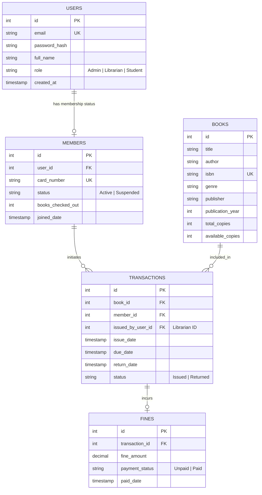

# Database Design and Schema Specification
## Project: Library Management System

This document details the relational database design for the Library Management System. It outlines the schema, constraints, data types, normalization details, and relationships.

---

### 1. Entity-Relationship (ER) Diagram

The following diagram models the entities in the library database and their relationships:

---

### 2. Schema Specification

#### 2.1 `users` Table
Stores authentication and basic identity details for all system actors (Admins, Librarians, and Students).

| Column Name | Data Type | Constraints | Description |
| :--- | :--- | :--- | :--- |
| `id` | SERIAL / INT | Primary Key, Auto-Increment | Unique identifier for the user. |
| `email` | VARCHAR(150) | Unique, Not Null | Login email address. |
| `password_hash` | VARCHAR(255) | Not Null | Hashed password using bcrypt. |
| `full_name` | VARCHAR(100) | Not Null | User's full name. |
| `role` | VARCHAR(20) | Not Null, Check Constraint | System role: `'Admin'`, `'Librarian'`, or `'Student'`. |
| `created_at` | TIMESTAMP | Default CURRENT_TIMESTAMP | Timestamp of account registration. |

#### 2.2 `members` Table
Stores membership-specific properties, linked to the `users` table. Only created for users with the `'Student'` role or general library members.

| Column Name | Data Type | Constraints | Description |
| :--- | :--- | :--- | :--- |
| `id` | SERIAL / INT | Primary Key | Unique member record identifier. |
| `user_id` | INT | Foreign Key -> `users(id)`, Unique, Cascade Delete | Links to the corresponding user account. |
| `card_number` | VARCHAR(50) | Unique, Not Null | Unique barcode/membership card number. |
| `status` | VARCHAR(20) | Not Null, Default `'Active'` | Account standing: `'Active'` or `'Suspended'`. |
| `books_checked_out`| INT | Default 0, Check (value <= 5) | Counter tracking active borrowings. |
| `joined_date` | TIMESTAMP | Default CURRENT_TIMESTAMP | Timestamp when membership started. |

#### 2.3 `books` Table
Stores details of the book titles cataloged in the library inventory.

| Column Name | Data Type | Constraints | Description |
| :--- | :--- | :--- | :--- |
| `id` | SERIAL / INT | Primary Key | Unique catalog identifier. |
| `title` | VARCHAR(255) | Not Null | Title of the book. |
| `author` | VARCHAR(255) | Not Null | Name of the author. |
| `isbn` | VARCHAR(20) | Unique, Not Null | International Standard Book Number (10 or 13 digits). |
| `genre` | VARCHAR(50) | Not Null | Categorization (e.g., Fiction, Science, Biography). |
| `publisher` | VARCHAR(150) | Nullable | Publisher's name. |
| `publication_year` | INT | Check (year <= CURRENT_YEAR) | Year of publication. |
| `total_copies` | INT | Not Null, Default 1, Check (value >= 0) | Total physical copies owned by the library. |
| `available_copies` | INT | Not Null, Check (value >= 0 AND value <= total_copies) | Copies currently on the shelves. |

#### 2.4 `transactions` Table
Tracks checked-out items, due dates, return statuses, and details of the librarian who approved the transaction.

| Column Name | Data Type | Constraints | Description |
| :--- | :--- | :--- | :--- |
| `id` | SERIAL / INT | Primary Key | Transaction identifier. |
| `book_id` | INT | Foreign Key -> `books(id)`, Not Null | Book copy involved. |
| `member_id` | INT | Foreign Key -> `members(id)`, Not Null | Borrower cardholder. |
| `issued_by_user_id`| INT | Foreign Key -> `users(id)`, Not Null | Staff user id who approved checkout. |
| `issue_date` | TIMESTAMP | Default CURRENT_TIMESTAMP | Checkout date. |
| `due_date` | TIMESTAMP | Not Null | Calculated return target date (e.g. `issue_date + 14 days`). |
| `return_date` | TIMESTAMP | Nullable | Timestamp when book was physically checked back in. |
| `status` | VARCHAR(20) | Default `'Issued'`, Check Constraint | State: `'Issued'` or `'Returned'`. |

#### 2.5 `fines` Table
Records overdue penalties linked to specific transaction logs.

| Column Name | Data Type | Constraints | Description |
| :--- | :--- | :--- | :--- |
| `id` | SERIAL / INT | Primary Key | Fine record identifier. |
| `transaction_id` | INT | Foreign Key -> `transactions(id)`, Unique | Link to the overdue checkout. |
| `fine_amount` | DECIMAL(10, 2)| Not Null, Default 0.00 | Penalty amount. Calculated as `$1.00` per overdue day. |
| `payment_status` | VARCHAR(20) | Default `'Unpaid'`, Check Constraint | Status: `'Unpaid'` or `'Paid'`. |
| `paid_date` | TIMESTAMP | Nullable | Timestamp when fine was cleared. |

---

### 3. Normalization Details (Third Normal Form - 3NF)

1.  **First Normal Form (1NF)**: All column values are atomic (e.g., no comma-separated authors, multiple phones are stored in separate attributes or users, and primary keys are defined for all tables).
2.  **Second Normal Form (2NF)**: All non-key attributes are fully functionally dependent on the entire primary key. In `members`, attributes like `card_number` and `status` depend on the member ID, not just a portion of a composite key.
3.  **Third Normal Form (3NF)**: No transitive dependencies exist. Fines are calculated and stored based on the transaction, and the customer data is obtained through the member profile rather than storing redundant name/phone fields in the transaction or fine records.

---

### 4. Integrity Constraints & Triggers

1.  **Stock Control Trigger (Procedural logic)**:
    *   *On Issue*: When a transaction is created, check if `books.available_copies` > 0. If yes, decrement by 1. Otherwise, abort transaction.
    *   *On Return*: When transaction `return_date` is updated, increment `books.available_copies` by 1.
2.  **Borrow Limit Constraint**:
    *   A member cannot issue a book if `members.books_checked_out` >= 5.
3.  **Dynamic Fine Calculation Rule**:
    *   `fine_amount` = `max(0, (return_date::date - due_date::date) * 1.00)` (assuming $1.00 daily fine).
