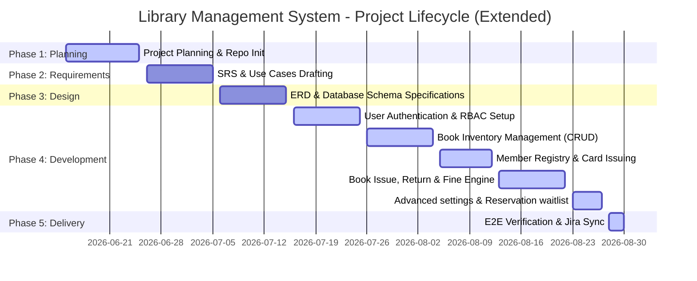

# Project Timeline & Schedule
## Project: Library Management System (LMS)

This document contains the project schedule, task hierarchy, milestones, and release windows. Each work item maps to the corresponding Jira SCRUM ticket, start/end dates, and completion status.

---

## 📅 Project Release Roadmap

---

## 🗂️ Epic-level Detailed Breakdown

### Epic 1: Project Setup & Lifecycle Setup (`LMS-SETUP`)
*   **Duration**: 2026-06-15 to 2026-06-25 (10 Days)
*   **Primary Objective**: Bootstrapping coding standards, bundlers, and setting up tracking frameworks.
*   **Work Items**:
    *   **`LMS-SETUP-1`**: Initialize repository, establish structural directory tree, and create documentation placeholders (`docs/`).
        *   *Date Range*: 2026-06-15 to 2026-06-18
        *   *Status*: Completed
    *   **`LMS-SETUP-2`**: Set up Vite developer environment, TypeScript configurations (`tsconfig.json`), and install package dependencies (React, Lucide icons, etc.).
        *   *Date Range*: 2026-06-19 to 2026-06-22
        *   *Status*: Completed
    *   **`LMS-SETUP-3`**: Configure the Jira SCRUM board, populate the initial product backlog, and plan Sprint 1 scope.
        *   *Date Range*: 2026-06-23 to 2026-06-25
        *   *Status*: Completed

### Epic 2: Requirement Analysis & System Design (`LMS-DESIGN`)
*   **Duration**: 2026-06-26 to 2026-07-15 (20 Days)
*   **Primary Objective**: System architecture modeling, relational normalization, and writing formal requirements.
*   **Work Items**:
    *   **`LMS-DESIGN-1`**: Author the Software Requirements Specification (SRS) specifying the functional boundaries and security regulations.
        *   *Date Range*: 2026-06-26 to 2026-06-30
        *   *Status*: In Progress
    *   **`LMS-DESIGN-2`**: Map user persona boundaries and draft structural Use Case scenarios.
        *   *Date Range*: 2026-07-01 to 2026-07-05
        *   *Status*: In Progress
    *   **`LMS-DESIGN-3`**: Create the Entity-Relationship Diagram (ERD) defining relational cardinality, primary keys, and foreign keys.
        *   *Date Range*: 2026-07-06 to 2026-07-10
        *   *Status*: In Progress
    *   **`LMS-DESIGN-4`**: Write normalized (3NF) relational database schema specifications and data dictionary tables.
        *   *Date Range*: 2026-07-11 to 2026-07-15
        *   *Status*: In Progress

### Epic 3: User Authentication & Role Security (`LMS-AUTH`)
*   **Duration**: 2026-07-16 to 2026-07-25 (10 Days)
*   **Primary Objective**: Implementing secure login systems, session persistence, and role protection.
*   **Work Items**:
    *   **`LMS-AUTH-1`**: Build credentials validation login interface (`Login.tsx`) with user-friendly validation states.
        *   *Date Range*: 2026-07-16 to 2026-07-20
        *   *Status*: In Progress
    *   **`LMS-AUTH-2`**: Implement `AuthContext.tsx` provider for login/logout actions and local storage session persistence.
        *   *Date Range*: 2026-07-21 to 2026-07-22
        *   *Status*: In Progress
    *   **`LMS-AUTH-3`**: Establish role routing constraints (Admin, Librarian, and Student views protection).
        *   *Date Range*: 2026-07-23 to 2026-07-25
        *   *Status*: In Progress

### Epic 4: Book Inventory Management (`LMS-BOOK`)
*   **Duration**: 2026-07-26 to 2026-08-04 (10 Days)
*   **Primary Objective**: Implementing book item CRUD services, validation parameters, and catalog search triggers.
*   **Work Items**:
    *   **`LMS-BOOK-1`**: Form-driven inventory panels allowing Librarians to add, edit, and archive book resources. Enforce validation of unique fields (ISBN).
        *   *Date Range*: 2026-07-26 to 2026-07-31
        *   *Status*: In Progress
    *   **`LMS-BOOK-2`**: Catalog browser view (`Books.tsx`) offering search bar filters (by Title, Author, Genre) and stock indices indicators.
        *   *Date Range*: 2026-08-01 to 2026-08-04
        *   *Status*: In Progress

### Epic 5: Member Registry Portal (`LMS-MEM`)
*   **Duration**: 2026-08-05 to 2026-08-12 (8 Days)
*   **Primary Objective**: Cardholder records setup, profile search, and account status controls.
*   **Work Items**:
    *   **`LMS-MEM-1`**: Register form capturing member details and generating card sequence series.
        *   *Date Range*: 2026-08-05 to 2026-08-08
        *   *Status*: In Progress
    *   **`LMS-MEM-2`**: Member logs dashboard listing currently borrowed documents, historic returns, and fines.
        *   *Date Range*: 2026-08-09 to 2026-08-10
        *   *Status*: In Progress
    *   **`LMS-MEM-3`**: Account standing check policies (suspending active transactions if fines exceed thresholds).
        *   *Date Range*: 2026-08-11 to 2026-08-12
        *   *Status*: In Progress

### Epic 6: Circulation Core: Book Issue & Return (`LMS-TX`)
*   **Duration**: 2026-08-13 to 2026-08-22 (10 Days)
*   **Primary Objective**: Core transaction logging engine for checkouts, returns, and due target updates.
*   **Work Items**:
    *   **`LMS-TX-1`**: Book Checkout transaction handler. Validates copies availability, checks borrower active state, and updates book copy counts.
        *   *Date Range*: 2026-08-13 to 2026-08-17
        *   *Status*: In Progress
    *   **`LMS-TX-2`**: Return check-in handler. Restores copy count indexes and flags loan logs state to returned.
        *   *Date Range*: 2026-08-18 to 2026-08-20
        *   *Status*: In Progress
    *   **`LMS-TX-3`**: Overdue date comparison logic. Triggers daily fine accumulation routines on overdue items.
        *   *Date Range*: 2026-08-21 to 2026-08-22
        *   *Status*: In Progress

### Epic 7: Advanced Policies, Waitlist & Dashboard (`LMS-ADV`)
*   **Duration**: 2026-08-23 to 2026-08-27 (5 Days)
*   **Primary Objective**: Real-time queues, waitlists for out-of-stock items, and custom administrative thresholds settings.
*   **Work Items**:
    *   **`LMS-ADV-1`**: Admin Borrowing Policy Dashboard (`Settings.tsx`) allowing live configuration updates to borrowing durations, checkout ceilings, and fine rates.
        *   *Date Range*: 2026-08-23 to 2026-08-24
        *   *Status*: In Progress
    *   **`LMS-ADV-2`**: Book Reservation Queue for out-of-stock items, student waitlist tracker (`MyLoans.tsx`), and auto-fulfillment triggers upon return check-ins.
        *   *Date Range*: 2026-08-24 to 2026-08-26
        *   *Status*: In Progress
    *   **`LMS-ADV-3`**: Librarian analytics view, active reservation list widgets, and fine collections logs.
        *   *Date Range*: 2026-08-26 to 2026-08-27
        *   *Status*: In Progress

### Epic 8: Verification & Delivery (`LMS-TEST`)
*   **Duration**: 2026-08-28 to 2026-08-30 (3 Days)
*   **Primary Objective**: Production verification, code linting, compiler check validations, and project package uploads.
*   **Work Items**:
    *   **`LMS-TEST-1`**: Validate compiler standards compliance (`verbatimModuleSyntax` rules), resolve code warnings, and verify build bundles (`npm run build`).
        *   *Date Range*: 2026-08-28 to 2026-08-29
        *   *Status*: In Progress
    *   **`LMS-TEST-2`**: Deliver final codebase packages, update status documents, and submit Jira tickets attachments for completion approval.
        *   *Date Range*: 2026-08-30 to 2026-08-30
        *   *Status*: In Progress
