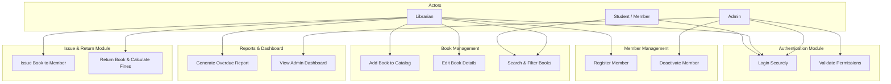

# Software Requirements Specification (SRS)
## Project: Library Management System

---

### 1. Introduction

#### 1.1 Purpose
This document specifies the software requirements for the **Library Management System (LMS)**. It describes the scope, functional requirements, non-functional requirements, user personas, and system interfaces. This document serves as the single source of truth for the development team and stakeholders.

#### 1.2 Scope
The Library Management System is a web-based application designed to automate library operations. It enables:
*   **Librarians** to manage the catalog (books), track library members, issue and return books, and monitor fines.
*   **Students/Members** to search for available books, view their borrowing history, and check outstanding fines.
*   **Admins** to manage system users (librarians and members), oversee overall inventory, and review financial/activity reports.

#### 1.3 Definitions & Acronyms
*   **SRS**: Software Requirements Specification
*   **WBS**: Work Breakdown Structure
*   **ERD**: Entity Relationship Diagram
*   **JWT**: JSON Web Token (for secure session authentication)
*   **RBAC**: Role-Based Access Control
*   **CRUD**: Create, Read, Update, Delete

---

### 2. Overall Description

#### 2.1 Product Perspective
The LMS is a standalone web application utilizing a modern frontend (e.g., React + TypeScript) interacting with a backend REST API (Node.js/Express or similar) and a database (relational PostgreSQL/MySQL or document-based MongoDB). 

#### 2.2 System Use Case Model
The following diagram illustrates the relationship between users (Actors) and the primary system features (Use Cases):

#### 2.3 User Classes & Characteristics
1.  **Administrator (Admin)**: Full administrative access. Responsible for user management (adding librarians, setting system configurations like fine rates and borrowing limits).
2.  **Librarian**: Operators of the library. Handles cataloging, issuing/returning books, managing member profiles, and tracking due dates/fines.
3.  **Student/Member**: End-users of the library. Can view catalogs, search for items, and check their profile for currently issued books and overdue charges.

#### 2.4 Operating Environment
*   **Client**: Modern web browsers (Chrome, Firefox, Safari, Edge).
*   **Server**: Node.js runtime environment.
*   **Database**: Relational database (SQL).

---

### 3. Functional Requirements (Mapped to Jira Backlog)

Here are the detailed User Stories and Acceptance Criteria grouped by Epics:

#### Epic 1: User Authentication (Auth)
*   **Story ID: LMS-AUTH-01**
    *   **Title**: Secure Login
    *   **User Story**: *As a registered user (Admin, Librarian, Student), I want to log in with my email and password so that I can access my personalized dashboard and features.*
    *   **Story Points**: 3
    *   **Acceptance Criteria**:
        1. Form checks for valid email format and minimum password length (8 characters).
        2. On success, a JWT token is generated and stored securely.
        3. Users are redirected to their respective landing pages based on their role (Admin -> User Admin, Librarian -> Issue Board, Student -> Book Search).
        4. Clear error messages are displayed for incorrect credentials.

#### Epic 2: Book Management (Book Catalog)
*   **Story ID: LMS-BOOK-01**
    *   **Title**: Manage Book Catalog (CRUD)
    *   **User Story**: *As a librarian, I want to add, edit, and remove books in the system catalog so that the inventory is kept up to date.*
    *   **Story Points**: 5
    *   **Acceptance Criteria**:
        1. Librarians can add a book with: Title, Author, ISBN, Genre, Publisher, Publication Year, and Total Copies.
        2. ISBN must be validated to prevent duplicates.
        3. Removing a book must be restricted if copies are currently checked out (soft-delete recommended).
*   **Story ID: LMS-BOOK-02**
    *   **Title**: Book Search and Filtering
    *   **User Story**: *As a member or librarian, I want to search and filter books by Title, Author, ISBN, or Genre so that I can quickly find if a book is available.*
    *   **Story Points**: 2
    *   **Acceptance Criteria**:
        1. The search bar provides instant/debounced search queries.
        2. Filters can narrow results down to currently available books.

#### Epic 3: Member Management (Members)
*   **Story ID: LMS-MEM-01**
    *   **Title**: Register and Manage Members
    *   **User Story**: *As a librarian, I want to register new members and view their status so that we can track borrowing eligibility.*
    *   **Story Points**: 3
    *   **Acceptance Criteria**:
        1. Registration form captures: Full Name, Email, Phone Number, Join Date, and Membership Status (Active/Suspended).
        2. Generates a unique Library Card Number.
        3. Librarians can suspend accounts for members with overdue books exceeding 30 days or unpaid fines exceeding a threshold.

#### Epic 4: Book Issue & Return (Transactions)
*   **Story ID: LMS-TX-01**
    *   **Title**: Issue a Book
    *   **User Story**: *As a librarian, I want to check out a book to a member so that we can record who has the book and when it is due.*
    *   **Story Points**: 5
    *   **Acceptance Criteria**:
        1. System checks book availability (Available Copies > 0).
        2. System verifies member status is active and they haven't exceeded the borrowing limit (e.g., maximum 5 books).
        3. Generates a transaction record with: Issue Date, Due Date (default 14 days from issue), and Status = 'ISSUED'.
        4. Decrements the available copy count of the book.
*   **Story ID: LMS-TX-02**
    *   **Title**: Return a Book and Calculate Fines
    *   **User Story**: *As a librarian, I want to process a book return, update availability, and calculate fines if the book is overdue.*
    *   **Story Points**: 5
    *   **Acceptance Criteria**:
        1. Marks transaction status as 'RETURNED' and updates the return date.
        2. Increments the available copy count.
        3. If Return Date > Due Date, dynamically calculates fine: `$1.00` per day overdue.
        4. Links any calculated fine to the member's account.

#### Epic 5: Reports & Dashboard
*   **Story ID: LMS-REP-01**
    *   **Title**: Dashboard Analytics Widgets
    *   **User Story**: *As an Admin or Librarian, I want to see key metrics on a dashboard (Total Books, Checked Out Books, Overdue Members, Active Fines) so that I can get an immediate health status of the library.*
    *   **Story Points**: 3
    *   **Acceptance Criteria**:
        1. Real-time counter metrics displayed on the main admin panel.
        2. A table displaying the top 5 most frequently borrowed books.

---

### 4. Non-Functional Requirements

#### 4.1 Security
*   All passwords must be stored using cryptographically secure hashing functions (e.g., bcrypt).
*   Role-Based Access Control (RBAC) must prevent Students from accessing Librarian configurations or CRUD endpoints.
*   HTTPS must be enforced for all server-client communications.

#### 4.2 Usability
*   The system UI should be highly responsive (mobile and desktop friendly).
*   All forms must have inline validation feedback to prevent submission errors.

#### 4.3 Performance
*   Search results must render in less than 500ms under a mock load of 10,000 book records.
*   Database indexing must be configured on frequently queried fields (`ISBN`, `email`, `member_card_number`).
